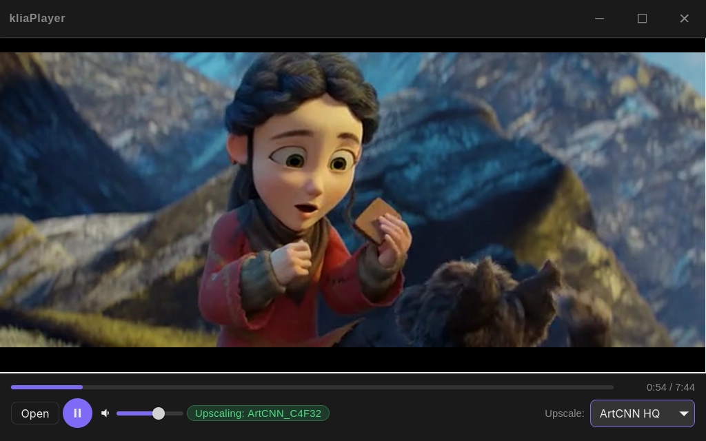

# Klia Scaler Player

Video player with real-time AI upscaling, built on [mpv](https://mpv.io) and libplacebo. It upscales lower-resolution video on your GPU so it looks sharper on a larger screen.

*Frame upscaled in real time from a 240p source using the ArtCNN High shader.*

Sample footage: *Spring* © Blender Foundation | [studio.blender.org/films/spring](https://studio.blender.org/films/spring/), licensed under [Creative Commons Attribution 4.0 (CC BY 4.0)](https://creativecommons.org/licenses/by/4.0/). The video was downscaled to 240p for this demonstration.

## Features

- GPU-rendered playback powered by mpv (`gpu-next`)
- Real-time upscaling profiles: FSR, ArtCNN and Anime4K
- SDR and HDR support, with automatic fallback to an HDR-safe profile
- Fullscreen mode and the usual playback controls
- Wide format support (MP4, MKV, AVI, MOV, WebM and more)

## Platforms

Linux first (Flatpak), Windows planned.
